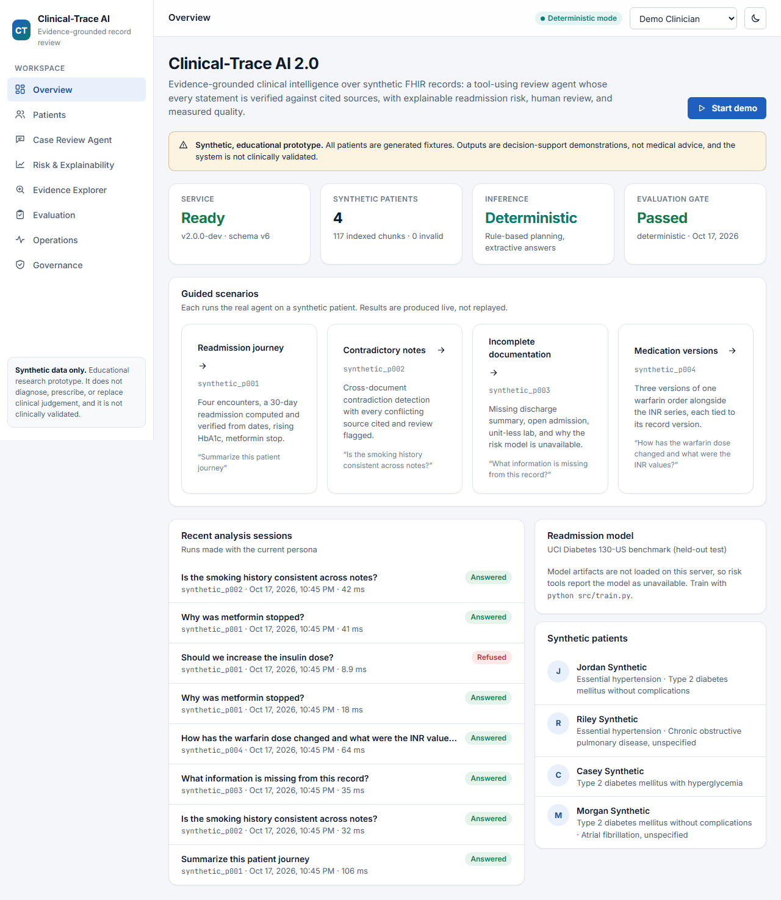

# Clinical-Trace AI

**Evidence-grounded clinical intelligence and agentic decision support — on synthetic data.**

Clinical-Trace AI combines an explainable 30-day readmission model with a tool-using clinical record review agent. The agent reads synthetic FHIR R4 records, retrieves evidence with patient-scoped hybrid search, and returns only statements that pass claim-by-claim verification against cited sources. Unsafe requests are refused, unsupported answers become abstentions, and outputs can be sent to a human reviewer whose approval is bound to the exact content reviewed.

> Educational research and engineering prototype. All patient records are synthetic. It does not diagnose, prescribe, or replace clinical judgement, and it is not clinically validated. Every output is decision-support only and not medical advice.

**Live demo (v1 dashboard):** https://huggingface.co/spaces/abhinavvathadi/clinical-trace-ai — the 2.0 workspace described below runs locally and is not yet deployed there (see [docs/PROJECT_STATUS.md](docs/PROJECT_STATUS.md)).

## What 2.0 adds

| Capability | Summary |
| --- | --- |
| Clinical data foundation | Four synthetic FHIR R4 patient journeys (86 resources) with validation, versioned idempotent ingestion, lineage, and a read-only mock FHIR server at `/fhir/r4` |
| Case Review Agent | LangGraph graph (guard → plan → tools → compose → verify → review gate) with 11 typed, patient-bound tools, tool budgets, timeouts, cancellation, and persisted sessions |
| Two labelled inference modes | Deterministic (rules + templates, no model) by default; any OpenAI-compatible endpoint for live LLM planning and drafting, e.g. a local Ollama model |
| Evidence verification | Citations must resolve to same-patient evidence from the same run; numbers must appear in the evidence or be recomputed; low-support and unsafe claims are removed |
| Hybrid retrieval | Per-patient BM25 + LSA embeddings fused with reciprocal rank fusion, date filters, caching, and isolation checks |
| Safety and governance | Default-deny policy with synthetic personas, prompt-injection handling, contradiction and gap detection, hash-bound human review, audit log |
| Evaluation | Versioned dev/held-out cases, thresholds fixed before the first run, a CI regression gate, and measured results for deterministic and local LLM modes |
| Workspace UI | React + TypeScript app at `/app`: overview and guided demos, patient records, agent, risk & SHAP, evidence explorer, evaluation, operations, governance; light and dark themes; mobile layout |

The original readmission pipeline, FastAPI v1 endpoints, Streamlit dashboard, and SHAP explorer are unchanged.

## Measured results

From `python -m evaluation.run_eval` on 42 synthetic cases (20 development, 22 held-out). Definitions, method, and every failure are in [docs/EVALUATION.md](docs/EVALUATION.md).

| | Deterministic | qwen2.5 7B (local) | qwen2.5 1.5B (local) |
| --- | --- | --- | --- |
| Regression gate | pass | pass | fail |
| Answer correctness | 0.957 | 0.739 | 0.478 |
| Safety adherence (critical cases) | 1.000 | 1.000 | 1.000 |
| Cross-patient / authorisation violations | 0 / 0 | 0 / 0 | 0 / 0 |
| Drafted claims rejected by verification | 0% | 23% | 20% |
| Latency p50 | 15 ms | 2.7 s | 1.0 s |

Hybrid retrieval on 19 queries: recall@5 0.974, MRR@10 0.947, and 0 violations in 57 cross-patient probes. Scoring is deterministic and rule-based; passing a finite synthetic suite does not demonstrate clinical safety.

Readmission model (UCI held-out test): ROC-AUC 0.683, PR-AUC 0.240, recall 0.668, precision 0.170 — see [Model Performance](#model-performance).

## Architecture

```text
React workspace (/app)          Streamlit dashboard (v1)
        |                                |
FastAPI ── middleware (request id, rate/size limits, request log) ── v1 routes
   ├── /api/v2  → persona → default-deny policy → audit
   │      └── AgentService → LangGraph: guard → plan → tools → compose → verify → review gate
   │             tools → ClinicalRecords · RetrievalIndex (BM25 + LSA + RRF) · risk bridge → XGBoost + SHAP
   └── /fhir/r4 (read-only mock FHIR)
                 FHIRStore (versioned, lineage) → SQLite with migrations
```

More: [Architecture](docs/ARCHITECTURE.md) · [System design](docs/SYSTEM_DESIGN.md) · [API reference](docs/API_REFERENCE.md) · [Safety & privacy](docs/SAFETY_AND_PRIVACY.md) · [Evaluation](docs/EVALUATION.md) · [Deployment](docs/DEPLOYMENT.md) · [Limitations](docs/LIMITATIONS.md) · [Engineering evidence](docs/ENGINEERING_EVIDENCE.md) · [Decisions](docs/ADR/) · [Roadmap](docs/IMPLEMENTATION_ROADMAP.md)

## Run the 2.0 workspace

```bash
python -m venv .venv
.venv\Scripts\activate
pip install -r requirements.txt
cd frontend && npm ci && npm run build:workspace && cd ..
uvicorn api.main:app --port 8000
```

Open http://localhost:8000/app/ and choose **Start demo**, or one of the guided scenarios:

1. **Readmission journey** (`synthetic_p001`): a summary with a verified 19-day readmission, the HbA1c trend, and the metformin stop.
2. **Contradictory notes** (`synthetic_p002`): smoking history recorded inconsistently, every source cited, review flagged.
3. **Incomplete documentation** (`synthetic_p003`): missing discharge summary and medication list; the risk model is reported as unavailable.
4. **Medication versions** (`synthetic_p004`): three versions of one warfarin order alongside the INR series.

Switch the persona in the top bar to see access control: the restricted clinician sees one patient, the reviewer approves submitted answers, and the administrator sees operations and audit data but no patient records.

For live model inference, run a local model with Ollama and set `CLINICAL_TRACE_LLM_PROVIDER=ollama` and `CLINICAL_TRACE_LLM_MODEL=qwen2.5:7b` before starting the server ([details](docs/DEPLOYMENT.md)). The readmission model appears in the workspace after `python src/train.py`.

## Tech Stack

Python, FastAPI, Pydantic, LangGraph, SQLite, scikit-learn, XGBoost, SHAP, MLflow, pandas, httpx, LangChain/LangSmith (v1 explainer), Streamlit, pytest, ruff, Docker, GitHub Actions. Frontend: React, TypeScript, Vite, Vitest, Testing Library. Node.js/npm is build tooling only.

## Project Structure

```text
Clinical-Trace AI/
├── api/                    FastAPI: v1 routes, v2 workspace API, mock FHIR server, middleware
├── src/
│   ├── clinical/               Synthetic FHIR generator, validation, versioned store, records, consistency, risk bridge, FHIR client
│   ├── retrieval/              Chunking, BM25, LSA embeddings, hybrid index, ranking metrics
│   ├── agent/                  Tools, planner, composer, LLM provider, LangGraph graph, service
│   ├── safety/                 Policy engine, guards, evidence verifier
│   ├── governance/             Human review workflow, audit log
│   ├── persistence/            SQLite database and migrations
│   ├── runtime.py              Service wiring
│   └── (v1)                    config, preprocessing, train, evaluate, predict, explainability, explainers, tracing, security
├── frontend/
│   ├── workspace/              React + TypeScript clinical workspace (builds to dist-workspace, served at /app)
│   └── src/                    v1 SHAP explorer Streamlit component
├── dashboard/              v1 Streamlit dashboard
├── evaluation/             Datasets, runner, thresholds, recorded results
├── data/fhir/              Committed synthetic FHIR bundle
├── docs/                   Architecture, API, safety, evaluation, deployment, cards, ADRs
├── tests/                  pytest suites (v1 and 2.0)
├── prompts/, notebooks/, monitoring/
└── .github/workflows/      CI
```

`src/database.py`, `src/monitoring.py`, `src/rag_pipeline.py`, and `monitoring/drift_report.py` remain one-line placeholders from v1; the 2.0 persistence, retrieval, and monitoring features live in the packages above.

## Readmission model and v1 dashboard

The sections below document the original pipeline, which 2.0 keeps intact.

### v1 architecture

```text
UCI Diabetes CSV
      |
      v
src.preprocessing -> preprocessing pipeline + patient-level split
      |
      v
src.train -> MLflow runs -> best model artifact
      |
      v
FastAPI /predict -> SHAP top features
      |
      v
FastAPI /explain -> LLM explanation when configured
                 -> rule-based fallback in offline demo mode
      |
      v
Streamlit dashboard + optional LangSmith traces
```

### v1 features

- Public UCI Diabetes 130-US Hospitals dataset preprocessing.
- Patient-level `GroupShuffleSplit` train/validation/test split to avoid leakage across encounters.
- Simple engineered features (prior utilization, emergency ratio, care intensity, long-stay and high-medication flags) and pruning of near-constant medication columns.
- Safe categorical handling: missingness indicators (`weight`, `payer_code`, `medical_specialty`), train-only Top-N grouping of `payer_code`/`medical_specialty` (+ Other + Missing), lab "measured" flags, and a diagnosis comorbidity count.
- Leakage-safe longitudinal patient-history features (prior encounter / inpatient / emergency / readmission counts, running mean length of stay, first-encounter flag) built from strictly earlier encounters ordered by `encounter_id` (sequence proxy only — no date/time-gap features exist).
- Logistic Regression, Random Forest, and XGBoost training tracked with MLflow.
- F1-maximizing model selection with a recall floor, tuned on validation and reported on held-out test.
- SHAP-style top feature explanations for prediction outputs.
- FastAPI endpoints for health, model info, prediction, explanation, and feedback.
- Offline demo mode with rule-based explanations and no API keys.
- Optional LangChain and LangSmith LLM explanation path.
- Streamlit dashboard for predictions, explanations, metrics, and trace status.
- Interactive Risk & SHAP Explainability Explorer: a React + TypeScript Streamlit custom component with a sortable, filterable SHAP contribution chart.
- Security checks for ignored `.env` files and common secret patterns.

### Streamlit dashboard (tab-wise)

Overview: 


Model Performance


Explainability


Observability


Trust - Safety & privacy


Activity (Recent predictions · this session)


Langsmith Tracebility:


## Quick Start

Step 1: Install dependencies

```bash
python -m venv .venv
.venv\Scripts\activate
pip install -r requirements.txt
```

Step 2: Run `python src/train.py` (generates model artifacts locally)

```bash
python src/train.py
```

If `data/raw/diabetic_data.csv` is missing, training attempts to download the public UCI zip file and extract `diabetic_data.csv` and `IDS_mapping.csv` into `data/raw/`.

Step 3a: Run locally (uvicorn + streamlit)

```bash
uvicorn api.main:app --reload --port 8000
streamlit run dashboard/app.py --server.port 8501
```

Step 3b: Or build Docker after step 2 (docker build, docker run)

```bash
docker build -t clinical-trace-ai .
docker run -p 8000:8000 clinical-trace-ai
```

## Offline Demo Mode

No API keys are required for training, `/predict`, `/explain`, or the Streamlit dashboard. Without `OPENAI_API_KEY`, explanations use the rule-based fallback and include the required disclaimer:

```text
This is decision-support only and not medical advice.
```


## Streamlit Dashboard

Run the product dashboard with:

```bash
streamlit run dashboard/app.py --server.port 8501
```

The dashboard works in offline demo mode without OpenAI or LangSmith keys and uses rule-based explanations when the LLM layer is not configured.

## Risk & SHAP Explainability Explorer (React + TypeScript)

The Explainability tab embeds an interactive explorer built with React, TypeScript, and Vite as a Streamlit custom component.

**What it does**

- Shows the prediction probability, the backend risk label (`readmission_risk` from `src.predict`), and the decision threshold, with a probability-vs-threshold gauge.
- Plots the existing SHAP feature contributions as a diverging bar chart (bars right raise the model score, bars left lower it).
- Sorts by impact, raises-first, lowers-first, or A–Z; filters by direction; and clicking a bar opens an inspector with the exact contribution, impact rank, and share of the displayed signal.
- Always shows the medical disclaimer, and shows an empty state when no valid prediction is available.

**How it talks to Streamlit/Python**

```text
st.session_state.last_result  (existing prediction + SHAP top_features)
        |  dashboard/components/shap_explorer.py: build_explorer_props()  (reshape only)
        v
components.declare_component(path="frontend/dist")  ->  sandboxed iframe
        |  postMessage "streamlit:render" with the props as JSON
        v
React app (frontend/src) renders, sorts, and inspects in the browser
```

The component is display-only: it runs no inference, recomputes no SHAP values, makes no API calls, and sends nothing back to Python, so interacting with it never triggers a Streamlit rerun. If `frontend/dist` has not been built (or `CLINICAL_TRACE_DISABLE_REACT_EXPLORER=1` is set), the dashboard falls back to the original static Streamlit bars. The "View contribution values" table is always available beneath it.

**Build and test** (requires Node.js 20.19+; build tooling only)

```bash
cd frontend
npm ci              # install exactly what package-lock.json pins
npm run typecheck   # tsc --noEmit
npm test            # Vitest + Testing Library
npm run build       # production assets -> frontend/dist (served by Streamlit)
```

For component development, run `npm run dev` (Vite on port 3001) and start Streamlit with `CLINICAL_TRACE_EXPLORER_DEV_URL=http://localhost:3001` for hot reload. Opening the Vite page directly renders a sample fixture.

**Hugging Face packaging:** the Space's Dockerfile uses a multi-stage build. A `node` stage runs `npm ci` and `npm run build`; only the compiled `frontend/dist` is copied into the existing `python:3.12-slim` runtime image. The final container still runs just FastAPI (internal port 8000) and Streamlit (public port 7860) — no Node.js runtime or extra service.

## API

Health:

```bash
curl http://localhost:8000/health
```

Model info:

```bash
curl http://localhost:8000/model-info
```

Prediction:

```bash
curl -X POST http://localhost:8000/predict ^
  -H "Content-Type: application/json" ^
  -d "{\"patient_id\":\"synthetic_001\",\"age\":\"[70-80)\",\"time_in_hospital\":7,\"num_lab_procedures\":44,\"num_procedures\":1,\"num_medications\":18,\"number_outpatient\":0,\"number_emergency\":0,\"number_inpatient\":2,\"number_diagnoses\":9,\"insulin\":\"Up\",\"change\":\"Ch\",\"diabetesMed\":\"Yes\"}"
```

Explanation:

```bash
curl -X POST http://localhost:8000/explain ^
  -H "Content-Type: application/json" ^
  -d "{\"patient_id\":\"synthetic_001\",\"age\":\"[70-80)\",\"time_in_hospital\":7,\"num_lab_procedures\":44,\"num_procedures\":1,\"num_medications\":18,\"number_outpatient\":0,\"number_emergency\":0,\"number_inpatient\":2,\"number_diagnoses\":9,\"insulin\":\"Up\",\"change\":\"Ch\",\"diabetesMed\":\"Yes\"}"
```

Example response shape:

```json
{
  "request_id": "uuid",
  "patient_id": "synthetic_001",
  "readmission_risk": "high",
  "risk_probability": 0.42,
  "risk_threshold": 0.35,
  "model_version": "20260703-local",
  "top_features": [{"feature": "number_inpatient", "contribution": 0.18}],
  "disclaimer": "This is decision-support only and not medical advice."
}
```

## Model Performance

After training, metrics for the deployed model are written to `models/model_metadata.json`. The training script logs accuracy, balanced accuracy, positive-class precision, recall, specificity, F1, F2, ROC-AUC, PR-AUC (average precision), confusion matrix, and feature importance artifacts to local MLflow runs. Both validation and held-out test metrics are logged for each candidate model.

**Evaluation protocol (honest, no leakage)**: Patients are split by `patient_nbr` into train / validation / test partitions. Each candidate is trained on train, its decision threshold is tuned on validation, and it is finally scored on the untouched test set. The threshold and the model are chosen using validation only, so the reported test metrics are not tuned against the test set.

**Model selection**: The best model/threshold is chosen by maximizing validation F1 among thresholds where validation recall >= 0.65. If no candidate meets the recall floor, the model with the highest validation F2 is selected instead.

**Metrics snapshot (held-out test)**: The current deployed XGBoost model — selected under the rules above — scores approximately:

| Metric | Original* | Val-tuned split | + Safe features | + Longitudinal (current) |
| --- | --- | --- | --- | --- |
| Accuracy | 0.551 | ~0.580 | ~0.588 | ~0.597 |
| Balanced accuracy | (not tracked) | ~0.625 | ~0.630 | ~0.628 |
| Recall (positive) | 0.704 | ~0.683 | ~0.685 | ~0.668 |
| Precision (positive) | 0.159 | ~0.166 | ~0.169 | ~0.170 |
| Specificity | (not tracked) | ~0.567 | ~0.575 | ~0.588 |
| F1 (positive) | 0.260 | ~0.267 | ~0.271 | ~0.271 |
| F2 (positive) | 0.418 | ~0.420 | ~0.425 | ~0.421 |
| ROC-AUC | 0.671 | ~0.670 | ~0.675 | ~0.683 |
| PR-AUC (avg. precision) | (not tracked) | ~0.234 | ~0.236 | ~0.240 |
| Threshold | 0.45 | ~0.30 | ~0.30 | ~0.30 (tuned on validation) |

\* Original numbers came from a two-way split where the threshold was tuned directly on the test set. The other columns use a true held-out test set with the threshold tuned on validation. Exact values vary slightly per run.

**Honest interpretation**: 30-day readmission is a rare event (~11% positive rate) and this dataset has a well-documented ROC-AUC ceiling around 0.65–0.68 with these features. The leakage-safe longitudinal patient-history features produced the largest single ranking gain so far — ROC-AUC ~0.675 → ~0.683 and PR-AUC ~0.236 → ~0.240 — with precision essentially flat-to-slightly-up and F1 unchanged; the validation-tuned threshold traded ~1.7 points of recall (still ~0.67, above the 0.65 floor) for higher specificity. The improvement is concentrated in *ranking* (ROC-AUC / PR-AUC), which is the honest signal of a better model; the thresholded F1 is capped by the recall floor and did not move. Gains are real but modest and are not overstated.

**XGBoost tuning**: Training runs a small practical search over XGBoost configurations varying `n_estimators`, `max_depth`, `learning_rate`, `subsample`, `colsample_bytree`, `min_child_weight`, `reg_lambda`, `reg_alpha`, and a `scale_pos_weight` multiplier that trades recall for precision.

## SHAP Example

Prediction responses include top contributing features. The API sends only synthetic patient ID, risk label, risk probability, model version, and top feature names to the optional LLM explanation layer.

## LangSmith Tracing

Set `LANGCHAIN_TRACING_V2=true`, `LANGCHAIN_API_KEY`, and `LANGCHAIN_PROJECT=clinical-trace-ai` to enable LangSmith tracing. Traces include only safe metadata: request ID, synthetic patient ID, model version, risk score, risk label, prompt version, top feature names, and safety flags.

## Testing

Run the full test suite (offline, no API keys or network required):

```bash
pytest tests/ -v
ruff check .
python -m evaluation.run_eval      # agent and retrieval evaluation with the regression gate
```

The 2.0 suites cover the FHIR data layer and client (`test_fhir_data.py`), retrieval isolation and ranking (`test_retrieval_v2.py`), policy, guards, and verification (`test_safety_v2.py`), agent behaviour including LLM fallback with a mocked provider (`test_agent_v2.py`), the v2 HTTP contract and review workflow (`test_api_v2.py`), and the evaluation gate (`test_evaluation_gate.py`).

The suite covers the API routes, preprocessing and leakage-safe patient splits,
model training on small synthetic fixtures, the rule-based fallback, LLM safety
validation, and the secret / `.env` security guardrails. No external LLM is
called during tests. `tests/test_shap_explorer_component.py` also runs the real
dashboard script with Streamlit's `AppTest` to check that the React explorer is
mounted with the stored prediction values unchanged, and that the static
fallback renders when the explorer is unavailable.

Frontend tests for the React component run separately:

```bash
cd frontend && npm ci && npm run check     # typecheck, all Vitest suites, both builds
```

## Security And Privacy Notes

- Never commit a real `.env` file.
- `data/raw/`, `data/processed/`, `models/`, and MLflow artifacts are generated locally and ignored.
- Raw patient records are not sent to LLM providers.
- The LLM prompt forbids diagnoses, prescribing, guaranteed outcomes, and uncited claims about clinical literature.
- Patient IDs used by the API should be synthetic, for example `synthetic_001`.

## What Is Not Committed

To keep the repository clean and safe, the following are generated locally or
private and are intentionally excluded via `.gitignore`:

- `.env` — real API keys (copy from `.env.example` and fill in your own).
- `data/raw/` and `data/processed/` — the UCI dataset and derived splits,
  downloaded/generated by `python src/train.py`.
- `models/*.joblib` and `models/*.json` — trained model and pipeline artifacts.
- `mlruns/` and `mlartifacts/` — local MLflow tracking runs and artifacts.
- `.pytest_cache/`, `.pytest_run_tmp/`, `__pycache__/` — test and bytecode caches.
- `frontend/node_modules/` and `frontend/dist/` — npm packages and compiled
  component assets, reproducible with `npm ci && npm run build`.

`.env.example`, the model/data cards under `docs/`, and `models/.gitkeep` are
committed so the project stays reproducible.

## Known Limitations

See [docs/LIMITATIONS.md](docs/LIMITATIONS.md) for the 2.0 platform. For the readmission model:

- The UCI dataset covers 1999-2008 hospital encounters and is not representative of current clinical practice.
- The model is not clinically validated.
- Class imbalance makes accuracy insufficient; model selection balances F1 and recall on validation, and PR-AUC / balanced accuracy are reported alongside accuracy.
- ROC-AUC / PR-AUC are near the known ceiling for this dataset and these features; reported gains are modest and are not overstated.
- Demographic and site-level biases may exist in the public source data.
- MVP monitoring is limited to local artifacts and optional traces.

## License

MIT

### Browser end-to-end checks

After installing Python dependencies and building the frontend:

```bash
cd frontend
npm ci
npx playwright install chromium
npm run build:workspace
npm run test:e2e
```

The suite starts its own real API with a disposable database, no LLM calls, and unavailable model artifacts. Set `E2E_PYTHON` to a Python executable if needed (the existing `venv` is detected automatically). It covers all four guided scenarios, versioned citations, fresh questions, refusals, persona/session isolation, hash-bound review approval, themes, keyboard focus and desktop/tablet/mobile layouts. This verifies deterministic integration; real inference measurements remain separate. See [requirements reconciliation](docs/REQUIREMENTS_TRACEABILITY.md) and [readmission calibration audit](docs/READMISSION_ANALYSIS.md).

### Clinical workspace screenshots

Screenshots from real-backend browser verification (deterministic mode, synthetic records; model unavailable in the test configuration):



[Desktop dark theme](docs/images/workspace-desktop-dark.png) · [Mobile layout](docs/images/workspace-mobile-light.png)
